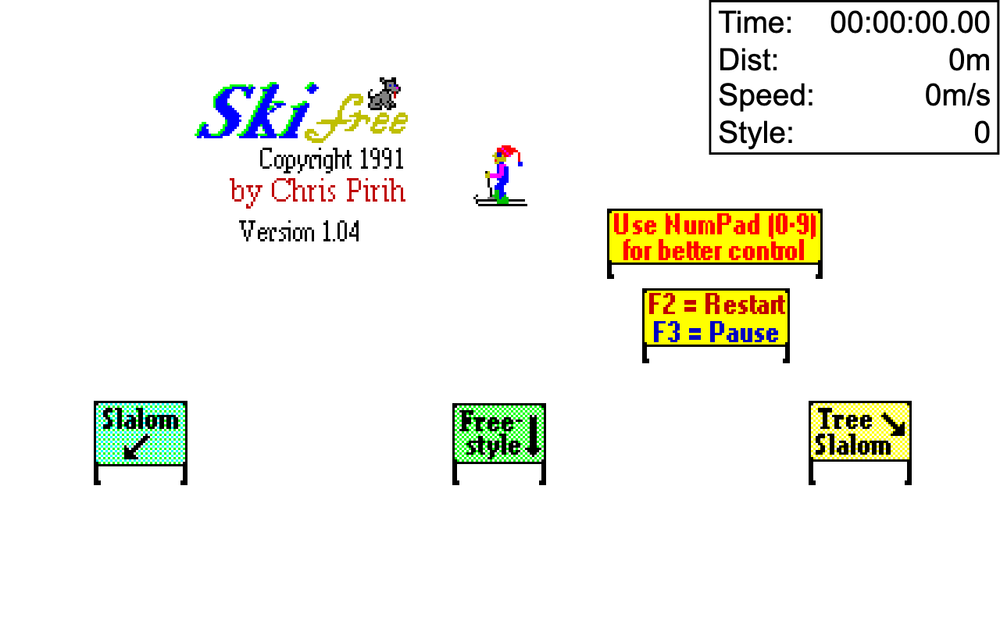

# SkiFree

A browser reconstruction of SkiFree 1.04, built by reverse engineering the original Windows executable. It uses the original artwork and reproduces the original game's rules. It runs in any modern browser, works offline, and needs nothing to install.

## Play

Play it in your browser at **[leosh64.github.io/skifree-browser](https://leosh64.github.io/skifree-browser/)**.

## Controls

| Input | Action |
| --- | --- |
| Left/right or keypad 4/6 | Turn through the original discrete headings |
| Down or keypad 2 | Point downhill |
| Up or keypad 8 | Uphill step or airborne trick, depending on state |
| Home, Page Up, End, Page Down / keypad 7, 9, 1, 3 | Direct headings |
| Insert or keypad 0 | Jump; Space is a browser convenience alias |
| Mouse movement / click | Aim / jump or change airborne trick |
| Touch drag / double tap | Aim / jump |
| F2 / F3 | Restart / pause and resume |
| F | Toggle fast mode |
| Enter or click after being eaten | Start again |

Held keys repeat at your operating system's key-repeat rate, as in the original game. Pause changes the browser tab caption.

## Courses

All three courses share one mountain. The signs below the start point the way to each one:

| Course | Where | Length | Flags |
| --- | --- | --- | --- |
| Slalom | Down and to the left | 500 m | 24 alternating single flags |
| Free Style | Straight down | 1,000 m | None |
| Tree Slalom | Down and to the right | 1,000 m | 39 alternating single flags |

Pass left of red flags and right of blue flags. A missed flag adds five seconds. Style points apply only during Free Style. Finishing shows High Scores, then skiing continues. Up to ten scores per course are stored locally in your browser. There is no telemetry or external network traffic.

## Notes

There is no sound: the original executable contains no sound resources, and this version does not invent any. It has been tested mainly in Chromium-based browsers; Safari, Firefox and physical mobile devices have not been verified.

## Building and reverse engineering

To build the HTML file yourself, run the tests, or read how the game was reverse engineered, see [BUILD.md](BUILD.md).

## Credits

Original SkiFree artwork and game are credited to **Chris Pirih**. Get the original from the [official SkiFree website](https://ski.ihoc.net/).
